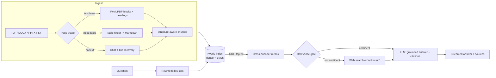

# DocPlainer

Chat with your documents. Upload PDFs (including **scanned** ones and **table-heavy** reports),
DOCX, PPTX, TXT or Markdown, then ask questions and get answers that **cite the page** they came
from. If your documents don't cover a question, the app says so, and can fall back to a clearly
labelled web search.

Everything runs on CPU with free models and free API tiers, so it deploys to a free Hugging Face
Space with no card on file.

> **Live demo:** _add your Space URL here after deploying (see [Deploy](#deploy-free))_

## What makes it more than a tutorial RAG

| Problem in naive RAG | What DocPlainer does |
|---|---|
| Scanned PDFs return nothing | Per-page triage: pages without a text layer are rendered and OCR'd (RapidOCR, ONNX, CPU). A coverage check re-reads text lines the detector skipped. Low-confidence pages produce a warning |
| Tables turn into word soup | Ruled tables are extracted as Markdown with their captions; OCR'd tables are rebuilt from column gaps. Tables are never cut mid-row, and large ones split by rows with the header repeated |
| Chunks lose their context | Headings build a section path (`Report > Revenue`). Every chunk is embedded with its file and section, and table chunks also carry a generated description |
| Dense search misses exact terms and numbers | Hybrid search: dense embeddings + BM25 (number-aware tokenizer), fused with Reciprocal Rank Fusion |
| Top-k is noisy | Retrieve wide, then a cross-encoder reranks the candidates |
| It always answers, even when it shouldn't | A relevance gate: below the threshold the app refuses or searches the web, and labels which one it did |
| Follow-ups ("and in 2023?") break retrieval | Follow-ups are rewritten into standalone queries; first questions skip that call |
| Citations are decorative | The model cites passage numbers; only passages it actually cited are shown, with the snippet (tables render as tables) |
| No way to know if a change helped | A golden question set and an eval harness that scores the **v1 pipeline vs v2** on the same questions |

## Architecture



The `docplainer/` package has no Streamlit dependency; `app.py` is a thin UI over it.

```
docplainer/
  ingestion/   pdf.py (triage), ocr.py, tables.py, parsers.py, chunking.py, pipeline.py
  retrieval/   embeddings.py, bm25.py, index.py (hybrid + RRF), rerank.py, retriever.py
  generation/  llm.py (free-provider fallback chain), prompts.py, answer.py, web.py
  eval/        dataset.py, baseline.py (v1), runner.py, __main__.py
  session.py   per-visitor index, demo limits
app.py         Streamlit UI
data/sample/   synthetic demo documents (digital, table-heavy, scanned)
data/eval/     golden questions
```

## Run locally

```bash
python -m venv .venv && source .venv/bin/activate      # Windows: .venv\Scripts\activate
pip install -r requirements-dev.txt && pip install -e .
cp .env.example .env                                   # add a free Groq and/or Gemini key
streamlit run app.py
```

Click **Load sample documents** to try it immediately, or upload your own. Models download on
first run (about 200 MB, cached afterwards).

Free keys (no billing needed): [Groq](https://console.groq.com),
[Google AI Studio](https://aistudio.google.com) and [NVIDIA](https://build.nvidia.com)
(`NVIDIA_API_KEY`; choose the model with `DOCPLAINER_NVIDIA_MODEL`). OpenRouter's `:free`
models also work. Providers are tried in that order: if one is rate-limited, the app moves to
the next. NVIDIA's hosted endpoints are intended for prototyping and testing and are
rate-limited, which suits a demo but is not a production service.

## Evaluate

```bash
python -m docplainer.eval --sweep
```

Prints hit@1 / hit@3 / hit@k / MRR per question type (text, table, scan), the share of
out-of-scope questions correctly refused, and a threshold sweep for tuning the relevance gate.
The same command runs in CI with real models and publishes the table to the job summary.

How it is scored: a retrieved passage counts as relevant if it comes from the right file and
page **and** contains the gold answer string, so the metric does not depend on how a pipeline
chunks text. The v1 baseline re-creates the original app (pypdf, fixed 800-character splits,
dense top-4, no gate) with the same embedder, so the comparison isolates the pipeline.

Caveat: the bundled corpus is small and synthetic (a fictional company). It is good for
catching regressions and for showing the scan and table paths work; it is not a benchmark. Bring
your own documents and questions to `data/eval/` for numbers that mean something to you.

## Deploy (free)

Hugging Face Spaces gives a CPU container with enough RAM for OCR and a reranker, and needs no
card.

1. Create a Space: **SDK = Docker**, hardware = **CPU basic**.
2. In the Space's *Settings -> Secrets*, add `GROQ_API_KEY` (and optionally `GOOGLE_API_KEY`).
   Use free-tier keys with no billing attached so traffic can throttle but never charge.
3. Push this repo to the Space, or let `.github/workflows/deploy-hf.yml` do it on every push to
   `main` (set the `HF_TOKEN` secret and the `HF_SPACE` variable).

Notes for a free Space: it sleeps after a period of inactivity and takes about a minute to wake;
disk is ephemeral, so each visitor's index lives in their session and disappears afterwards (no
strangers' documents are kept). Demo mode caps questions and uploads per session; visitors can
paste their own free key to lift the caps.

## Limitations

- OCR quality depends on scan quality. Recognition sometimes drops spaces between words; tables
  in scans are inferred from column gaps and can misalign on irregular layouts.
- Borderless (unruled) tables in digital PDFs are not detected and fall back to plain text.
- Chunks never span pages, which keeps citations exact but can split a sentence that crosses a
  page break.
- There is no groundedness verifier yet; the prompt requires citations but a model can still
  misread a table cell. The cited snippet is shown so answers can be checked.
- Free LLM tiers rate-limit. The provider fallback chain covers most of it, not all.
- Web fallback uses DuckDuckGo snippets, which are shallow by nature.

## Tests

```bash
pytest -q          # 50+ tests, offline, no model downloads
```
